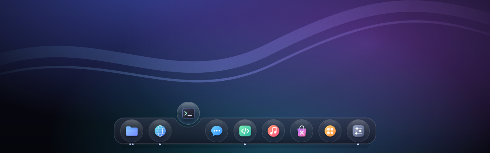

# X-OS

**BEYOND WINDOWS. BEYOND macOS.**

X-OS is a desktop operating system built on Debian 13, the Linux kernel and KDE
Plasma (Wayland), with its own integration layer: the *Liquid Glass* design
language and Signature Dock, one Control Center for the whole system, a Windows
Compatibility Engine (Wine/Proton), a unified app store, performance profiles
for old and new PCs, and a safety-first installer and recovery story.

> **Status: DEVELOPMENT.** The core live ISO builds and boots in virtual machines.
> There is no desktop image, no installer and no physical-hardware testing yet.
> **Do not install X-OS on a computer you depend on.** See
> [documentation/STATUS.md](documentation/STATUS.md) for exactly what works.



## Quick start (developers)

```bash
sudo scripts/setup-build-host.sh          # build dependencies (Debian/Ubuntu host)
scripts/run-tests.sh                      # unit tests + static checks
sudo build/build.sh                       # -> releases/out/x-os-<ver>-core-amd64.iso
sudo testing/vm/boot_test.py releases/out/x-os-0.1.0-dev-core-amd64.iso --firmware uefi
```

Details: [documentation/BUILDING.md](documentation/BUILDING.md).

## Documents

| | |
|---|---|
| [architecture/ARCHITECTURE.md](architecture/ARCHITECTURE.md) | Layer model, component choices, security model |
| [documentation/STATUS.md](documentation/STATUS.md) | What is implemented and how it was tested |
| [documentation/ROADMAP.md](documentation/ROADMAP.md) | Milestones M0–M12 and exit criteria |
| [documentation/RELEASE-GATES.md](documentation/RELEASE-GATES.md) | Release states and the evidence each requires |
| [documentation/SAFETY.md](documentation/SAFETY.md) | Disk and installation safety policy |
| [documentation/ENVIRONMENT.md](documentation/ENVIRONMENT.md) | Development environment report and its limits |
| [documentation/HARDWARE-TESTING.md](documentation/HARDWARE-TESTING.md) | Physical hardware test protocol |
| `*/MODULE.md` | Per-module status, dependencies, tests, known issues, acceptance criteria |

## Honest limits

X-OS runs many Windows programs through Wine and Proton, **not all**. Windows
kernel drivers, kernel-level anti-cheat, much DRM and most Microsoft Store apps
do not work. Where an official Linux version of an app exists, X-OS recommends it.

## License

X-OS's own code and artwork: Boost Software License 1.0 (see `LICENSE`).
The ISO bundles Debian packages under their own licenses, including redistributable
non-free firmware; the exact list ships as `live/filesystem.packages` on each ISO.
